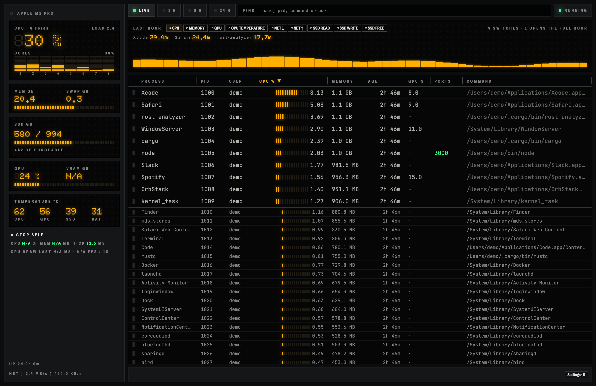
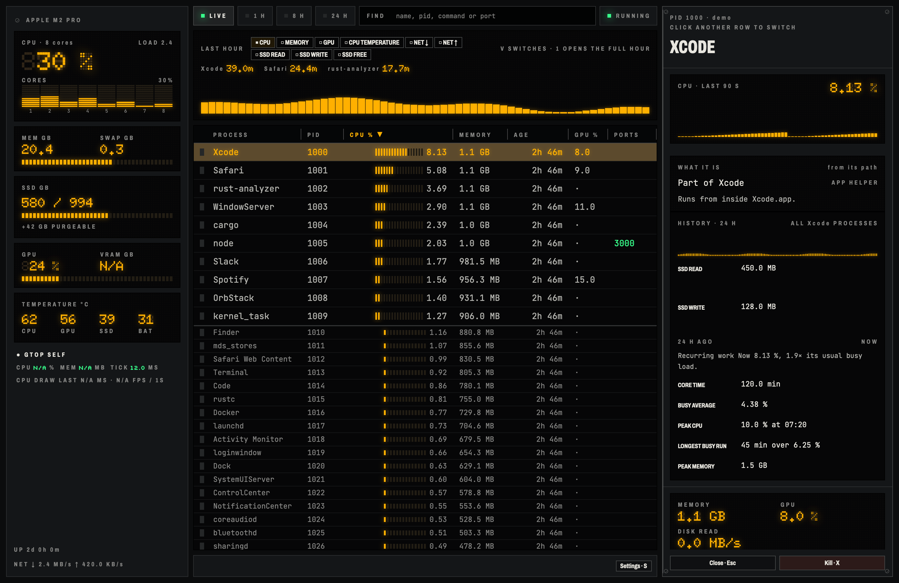
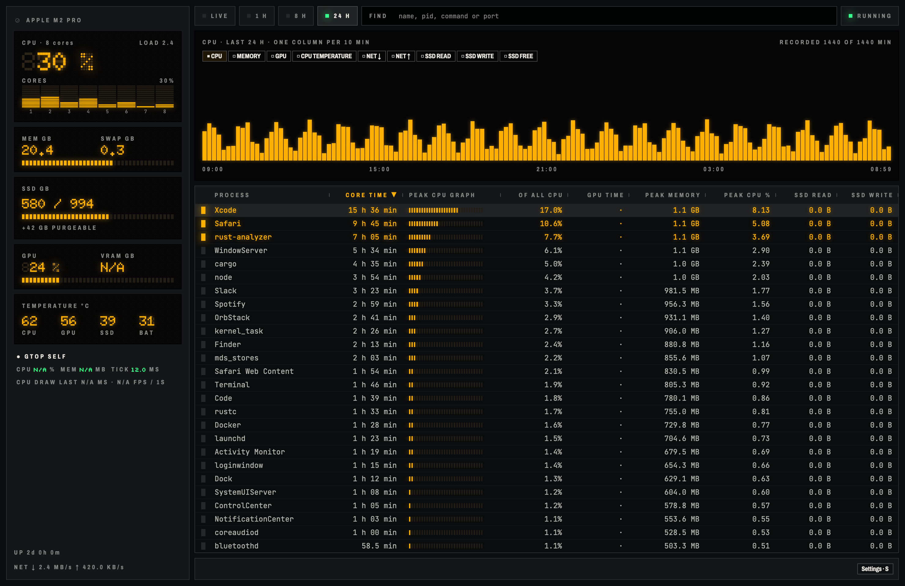

# gtop

gtop is a native macOS system monitor built with Rust and GPUI. It puts process activity and system resources in one window so you can find what makes your Mac busy. Native rendering keeps the interface fast without a browser engine.





## What it shows

- Processes with CPU, memory, GPU, and disk activity.
- Search by name, command, PID, or local port.
- CPU, memory, GPU, temperature, network, and storage panels.
- Process details, parent and child processes, and local ports.
- Recorded resource history and a disk browser.

Some sensors depend on your Mac and its permissions.

## Install

Use macOS 11 or later, Apple Silicon or Intel, with the Xcode Command Line Tools and stable Rust. The current build uses Rust 1.99.1. Each build targets the architecture of the build machine.

```sh
cargo install --locked --git https://github.com/gaboe/gtop gtop
```

Run `gtop` from your terminal. To build an app bundle instead, clone this repository and run:

```sh
sh crates/gtop/package-macos.sh
cp -R target/gtop-native/gtop.app /Applications/
```

Open gtop from Applications. The bundle uses an ad hoc code signature.

## Use

Click a column header to sort. Click again to reverse it. Select a process to open its details. Search accepts comma-separated alternatives. Use `:3000` or `port:3000` to find a local port. Port collection runs while a valid port search is active.

Use Tab and Shift-Tab to change views. Press / to search, J or K to move between processes, D for the disk browser, and Space to pause. Refresh intervals range from 1 to 10 seconds. The kill action asks for confirmation.

History and settings live in `~/Library/Application Support/gtop`. The app also writes its latest metrics to `now.json` there. See the [native app notes](crates/gtop/README.md) for details and screenshot generation.

## Check

```sh
cargo fmt --all -- --check
cargo clippy --workspace --all-targets -- -D warnings
cargo test --workspace
```

## License

[MIT](LICENSE).
